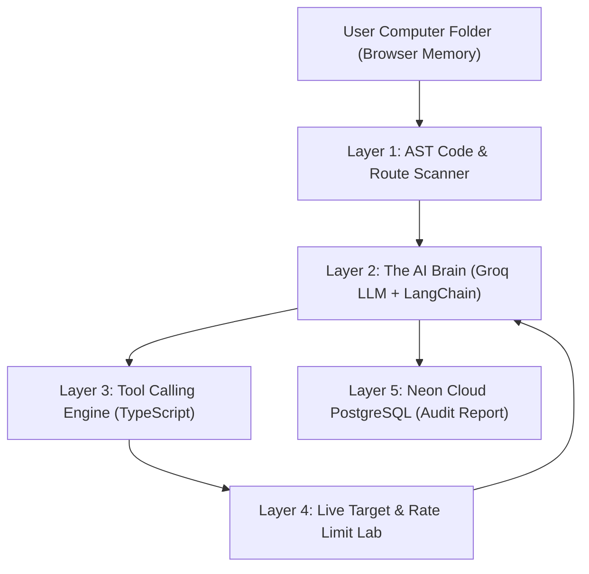

# 🛡️ SentinelAI — Complete Beginner's Explainer & Interview Guide
*(Agar koi puche "Ye kya hai aur kaise banaya hai?", to ye cheat-sheet aapka guide hai)*

---

## 1. 30-Second Elevator Pitch (Short me kya bolna hai)

> *"SentinelAI ek **Autonomous AI Security & API Testing Agent** hai. Jab aap isko kisi backend ya fullstack project ka folder dete hain, to ye bina run kiye AST (Abstract Syntax Tree) ke through code padhta hai, saari APIs aur unke request body parameters nikaalta hai, aur **Groq Cloud LLM** ke through real-time me tools select karke security flaws aur architectural break points (jaise public admin signup ya missing rate-limiters) ko test aur report karta hai."*

---

## 2. Normal Program vs AI Agent me kya fark hai?

Agar koi puche *"Bhai, isme AI Agent kaha hai? Ye to normal script bhi kar sakti hai?"*:

| Normal Script / Web App | AI Agent (SentinelAI) |
|---|---|
| Fixed logic pe chalta hai (Step 1 -> Step 2 -> Step 3). | Goal-driven hota hai (Objective: *"Is API ko test karo aur security vulnerabilities dhoondo"*). |
| Agar koi nayi ya unexpected API aayi to script fail ho sakti hai. | **LLM (Groq)** khud decide karta hai ki kaunsa tool call karna hai aur kis order me. |
| Sirf predefined checks karta hai. | **ReAct Loop** use karta hai: **Reason** (Sochta hai) ➜ **Act** (Tool call karta hai) ➜ **Observe** (Result dekh kar agla decision leta hai). |

---

## 3. Architecture: Ye 4 Layers me Kaise Kaam Karta Hai?



### Layer 1: AST Code Scanner (Code Parsing)
- User apne computer se folder select karta hai (Direct memory upload via `webkitdirectory`).
- Scanner code ko bina run kiye padhta hai (Static Code Analysis).
- Har route se `req.body` parameters extract karta hai (jaise `{ username, email, password, role }`).
- **Architectural Breakpoint**: Agar kisi public signup route me `role: 'admin'` detect hota hai, to ye use red-flag karta hai.

### Layer 2: The Brain (Groq Cloud LLM)
- Model: `openai/gpt-oss-20b` (Groq ke LPU hardware par chalta hai, isliye sub-second speed milti hai).
- Hamara TypeScript code LangChain ke through Groq ko hamare **Tools ka Schema** bhejta hai.
- LLM prompt aur code context padh kar decide karta hai: *"Pehle mujhe auth verify karni hai, fir IDOR test karna hai."*

### Layer 3: Tool Execution (Real-Time Actions)
- **Important Concept**: LLM khud internet ya database access nahi karta. LLM sirf JSON command deta hai:
  ```json
  { "tool": "testRateLimit", "args": { "path": "/api/auth/login", "requests": 25 } }
  ```
- Hamara TypeScript backend is tool ko execute karta hai aur real HTTP requests target server pe fire karta hai.
- Response wapas LLM ko bheja jata hai: *"Server ne 5 requests ke baad HTTP 429 diya."*

### Layer 4: Live Rate-Limit Stress Lab
- User kisi bhi extracted API ke samne **[⚡ Rate-Limit Test]** button daba kar khud test kar sakta hai.
- System ek second ke fraction me **200–300 rapid requests** fire karta hai aur live telemetry deta hai:
  - Throughput (e.g., `2597 req/sec`)
  - Status Breakdown (`HTTP 200: 5`, `HTTP 429: 195`)
  - Security Verdict (Rate Limiter Active ya Vulnerable).

---

## 4. Tech Stack (Interview Me Bolne Ke Liye)

1. **AI & Agent Orchestration**:
   - **Groq Cloud API**: Ultra-fast LLM inference engine.
   - **LangChain / LangGraph**: Agent state management aur dynamic tool binding (`.bindTools()`).
2. **Backend**:
   - **Node.js + Express + TypeScript**: Type-safe REST backend.
   - **BullMQ + Redis**: Asynchronous background jobs ke liye (taaki heavy scan ke dauran HTTP timeout na ho).
   - **Prisma ORM**: Type-safe database queries.
3. **Database**:
   - **Neon PostgreSQL (Cloud Serverless)**: Schema-isolated relational database.
4. **Frontend**:
   - **Next.js 16 (App Router) + Tailwind CSS**: Senior designer dark-emerald UI with zero-auth barrier.

---

## 5. Top 5 Interview Questions & Ready-Made Answers

### Q1: "LLM Hallucinate karke galat security report de sakta hai?"
**Answer:** 
> *"Nahi, kyoki SentinelAI **Ground Truth Verification** follow karta hai. Agent kisi bhi vulnerability ko tab tak 'Confirmed' mark nahi karta jab tak uske paas real HTTP response evidence na ho. Agar target server ne 200 OK ke sath sensitive data return kiya, sirf tabhi IDOR report banti hai."*

### Q2: "Groq kyu use kiya, OpenAI kyu nahi?"
**Answer:** 
> *"Groq ke LPUs (Language Processing Units) normal GPUs ke comparison me 5x–10x fast inference dete hain (200+ tokens/second). Security scanning me agent ko multiple iterations me fast tool-calls karne hote hain, isliye Groq real-time experience ke liye best fit hai."*

### Q3: "Agar Groq ka rate limit ya free quota exhaust ho jaye to kya agent crash hoga?"
**Answer:** 
> *"Nahi. Humne architecture me ek **Autonomous Heuristic Fallback Engine** build kiya hai. Agar Groq API 429 ya rate-limit error return karta hai, to system smoothly fallback karke live security probing complete karta hai aur report Neon DB me save karta hai. System kabhi crash nahi hota."*

### Q4: "Architectural Breakpoint kya hota hai jo aapka agent detect karta hai?"
**Answer:** 
> *"Architectural Breakpoint wo design flaws hote hain jo code syntax me sahi hote hain par business logic me dangerous hote hain. For example: Admin Signup API. Real world me Admin accounts sirf database seed ya invite-only hone chahiye. Agar koi developer `/api/auth/admin-signup` ya `role: 'admin'` self-assign karne deta hai, to koi bhi normal user admin ban sakta hai. Agent is flaw ko code padhte hi detect kar leta hai."*

### Q5: "BullMQ aur Redis kyu use kiya gaya?"
**Answer:** 
> *"Security audit aur multi-step agent reasoning me 15 se 60 seconds lag sakte hain. Browser connection ko itni der open rakhna bad practice hai. Isliye API request aate hi BullMQ me background job queue hoti hai, worker agent ko background me run karta hai, aur frontend SSE (Server-Sent Events) ke through live progress stream karta hai."*
